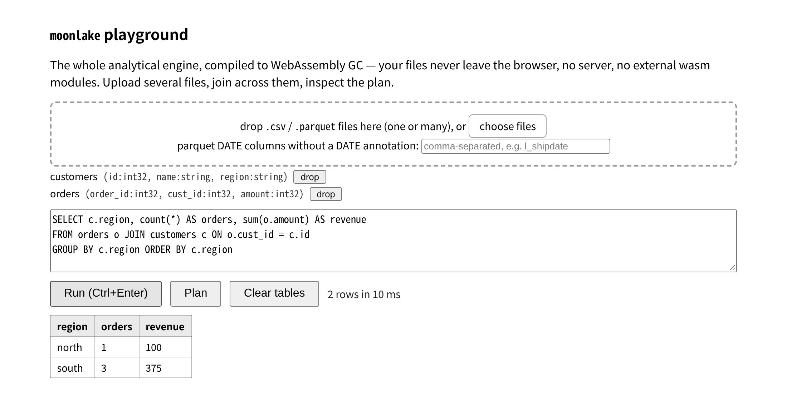

# moonlake

[](https://github.com/superbigcup325/moonlake/actions/workflows/ci.yml)

An embeddable, columnar SQL engine for analytics, written in MoonBit: run SQL over
CSV and Parquet files in-process, native or in the browser, from one codebase.



**[Open the playground](https://superbigcup325.github.io/moonlake/)** — the whole engine
as wasm-gc, all client-side. Drag in one or more CSV/Parquet files, write SQL, get a
columnar result, inspect the physical plan. No install, nothing uploaded.

Latest release **0.6.3** (2026-10-31) on
[mooncakes](https://mooncakes.io/docs/superbigcup325/moonlake), Apache-2.0. This README
and the playground track `main`; what has landed since 0.6.3 is under *Unreleased* in
[CHANGELOG.md](CHANGELOG.md).

## What it is

- **A query engine over files, not a database.** Register CSV/Parquet files as tables,
  run SQL, get columnar result batches. There is no storage engine, no server and no
  FFI binding to a database: the parser, binder, planner, vectorized operators, hash
  join, aggregates, windows and spill store are all in this repository
- **Two data sources, read and written in-house.** CSV types are inferred (integers
  widen instead of wrapping, a ragged row is refused by row number). The Parquet reader
  and writer handle a stated subset of the format and refuse the rest with a pointed
  error rather than guessing — [docs/sources.md](docs/sources.md)
- **Native and browser from one build.** The same packages produce a single native
  binary for the command line and a wasm-gc module for the playground; it also builds
  for `js`. Only the filesystem differs: a small private POSIX stub (`platform/io`)
  gives native reads and writes their byte ranges and streaming, and wasm-gc/js read
  whole files because their host has no ranged read
- **Larger-than-memory queries degrade honestly.** Under `--memory`, a blocking
  `ORDER BY` spills to sorted runs and streams its result back; large joins and
  `GROUP BY`s partition their inputs and aggregate one partition at a time. What
  cannot be made to fit is refused with the reason, not OOM-killed
- **Verified against DuckDB.** All 22 TPC-H queries pass on their official texts within
  a 1e-9 relative tolerance, plus property tests, a pushdown fuzzer and the Parquet
  testing corpus — see [docs/verification.md](docs/verification.md)

## Quickstart

```bash
git clone https://github.com/superbigcup325/moonlake && cd moonlake
moon update
moon run cmd/main -- exec --csv harness/data/sf001/lineitem.csv \
  "SELECT l_returnflag, sum(l_extendedprice) FROM lineitem WHERE l_shipdate <= date '1998-09-02' GROUP BY l_returnflag ORDER BY l_returnflag"
# l_returnflag|sum_2
# A|532348211.6499983
# ...
```

The checkout carries the SF0.01 TPC-H data, so that query runs as written. CI pins
`moonc` 0.10.18 (`0.10.18+6c83a7f62`); the supported floor is 0.10.16, and a nightly
job checks `latest` separately.

### Install the binary

```bash
moon build cmd/main --target native --release
install -m755 _build/native/release/build/cmd/main/main.exe ~/.local/bin/moonlake
moonlake exec --csv lineitem.csv --file q6.sql     # SQL from a file: no shell quoting
```

Every flag, output mode, plan and spill behaviour: [docs/cli.md](docs/cli.md).

### Use it as a library

`moon add superbigcup325/moonlake`, then name the packages you import in the `moon.pkg`
of the package that uses them (`moon new` puts `main` in `cmd/main`, so that is the
file to edit):

```text
import {
  "superbigcup325/moonlake",
  "superbigcup325/moonlake/catalog",
  "superbigcup325/moonlake/sources/csv",
}
```

```moonbit nocheck
// a @catalog.Catalog with registered table entries — @csv/@parquet
// scan into one; note the argument order: content/name, not name/content.
// registration is lazy: the schema is available at once, and a query decodes
// only the columns it projects, in 2048-row batches

///|
fn main raise {
  let cat = @catalog.Catalog::new()
  cat.register(@csv.scan_string("region,amount\nnorth,100\n", "events"))

  // read results back cell by cell: names() gives the columns,
  // row_count() the rows, get(row, col) a @types.Scalar (null via Null)
  let result = @moonlake.execute(
    "SELECT region, count(*) FROM events GROUP BY region", cat,
  )
  for r in 0..<result.row_count() {
    println(result.get(r, 0).to_string() + "|" + result.get(r, 1).to_string())
  }
}
```

`examples/basic/` is the snippet above as a compiled package, and `examples/stream/`
is the streaming snippet: `moon run examples/basic`, `moon run examples/stream`.
Batches instead of collected results: [docs/streaming.md](docs/streaming.md).

## SQL surface

- `SELECT` (including `*`) / `FROM` (multi-table) / `WHERE` / `GROUP BY` / `HAVING` /
  `ORDER BY` / `LIMIT`, `INNER` / `LEFT` / `RIGHT` / `FULL` / `CROSS` joins,
  `UNION [ALL]` / `INTERSECT` / `EXCEPT`, derived tables, non-recursive `WITH` CTEs
- Expressions, aggregates (`count(DISTINCT)`, `median`, `string_agg`, and the explicit
  `approx_count_distinct` / `approx_quantile` sketches), window functions, and
  correlated subqueries anywhere an expression may appear — three-valued NULL logic
  throughout, integer overflow raises instead of wrapping
- Semantics follow DuckDB and PostgreSQL where the engines could differ — rounding,
  division, integer-literal widening, float → integer casts — and every deviation from
  C/SQLite/MySQL is stated

Each refusal, and what is out of scope on purpose, is in
[docs/sql-surface.md](docs/sql-surface.md); approximate-aggregate rules are in
[docs/sketches.md](docs/sketches.md).

## Verification

SQL correctness is differential testing against DuckDB over TPC-H: **all 22 queries
pass on their official texts** (annex parameter values, dbgen directives stripped),
every result within 1e-9 relative tolerance on SF0.01. The whole chain runs in CI —
job `tpch` regenerates the data and DuckDB's answers from scratch, then diffs every
query:

```bash
uv run --with duckdb python harness/gen_tpch.py   # TPC-H SF0.01 data + goldens
bash harness/check_all.sh                         # 33 goldens: all PASS (22 TPC-H + parquet + encoding variants)
MOONLAKE_DATA=harness/data/sf01 bash harness/check_all.sh   # same at SF0.1 (regenerate first: gen_tpch.py 0.1)
```

One documented deviation: Q15's official text materializes a view with
`CREATE VIEW ... ; SELECT ...; DROP VIEW ...`, and the engine executes single
statements, so the harness runs its sanctioned `WITH` spelling of the same query
(`harness/queries/q15.sql`), which DuckDB answers identically.

420 unit tests, the 33 goldens, a real-browser playground run and Parquet writer
interop run on every push; the report that explains each result is
[docs/verification.md](docs/verification.md), section by section, with the command
that reproduces it.

### Performance, for information

SF0.01, best of 3, one machine, both engines, via `harness/bench.py`, refreshed
2026-10-31. Times include process start and reading the CSV from disk:

| query | moonlake native | duckdb |
|---|---|---|
| Pricing Summary Report (q1) | 100 ms | 3.5 ms |
| Forecasting Revenue Change (q6) | 68 ms | 1.1 ms |
| Product Type Profit Measure (q9) | 93 ms | 4.7 ms |
| Shipping Modes and Order Priority (q12) | 89 ms | 2.6 ms |

All 22 queries land between 10 ms and 129 ms against DuckDB's 1.1 ms to 6.1 ms;
`harness/bench.py` prints the set. DuckDB is in-process over pre-loaded tables — the
same q6 from a fresh `read_csv_auto` costs it 49 ms, where moonlake's own byte-level
reader plus the columnar evaluator lands at 67 ms. The four queries measured against
the original row-at-a-time build took 539–995 ms on this machine. Release-to-release
records and the machine they belong to: [docs/bench-baseline.md](docs/bench-baseline.md).

`--explain` prints the plan and `--analyze` adds per-stage rows and times plus what a
budgeted run spilled; a scan line says what it will read (`row groups: k of n read`
when statistics eliminated some).

## Docs

- **Playground** ([open](https://superbigcup325.github.io/moonlake/), [the plan panel
  and a result](docs/images/playground-plan.png)): register several CSV/Parquet files
  in a visible session, run cross-file joins, inspect the physical plan, drop tables
  or clear the session — the whole engine as wasm-gc, all client-side
- **[docs/DEMO.md](docs/DEMO.md)**: the reproducible demo, from running the engine to
  the DuckDB cross-check and the benchmark
- **[docs/cli.md](docs/cli.md)**: the `moonlake` command — inputs, output modes, plans,
  memory budgets and spilling
- **[docs/sql-surface.md](docs/sql-surface.md)**: the SQL that is accepted, the
  semantics it follows, and what is refused
- **[docs/sources.md](docs/sources.md)**: CSV inference and ranged scans, the Parquet
  reader and writer scope, streaming IO per target
- **[docs/streaming.md](docs/streaming.md)**: `stream` / `next()` — which shapes are
  pulled rather than collected, and the lifecycle
- **[docs/verification.md](docs/verification.md)**: the correctness and performance
  report (differential and property testing, pushdown fuzzing, memory and spill
  numbers)
- **[docs/bench-baseline.md](docs/bench-baseline.md)**: the release performance
  baseline and the machine it belongs to, with a committed JSON record and a
  `--compare` mode
- **[docs/spill-survey.md](docs/spill-survey.md)**: how six systems handle
  larger-than-memory queries, and where moonlake's design lands
- **[docs/devlog.md](docs/devlog.md)**: the build log, week by week
- **[docs/ROADMAP.md](docs/ROADMAP.md)**: what is being worked towards, what is refused
  on purpose, and what would start a direction currently on hold
- **[CHANGELOG.md](CHANGELOG.md)**: release notes

## Where moonlake sits

MoonBit's ecosystem had SQL parsers and format readers, but no query engine over them.
moonlake fills the compute layer and sits next to, not on top of, its neighbours:

| project | what it is | boundary with moonlake |
|---|---|---|
| [moonbit-community/sqlparser](https://github.com/moonbit-community/sqlparser) | SQL lexer/parser (AST) | parsing only, no execution; moonlake runs its own front-end (`sql/`) because sqlparser's select-statement AST is not destructurable cross-package, so the relationship is upstream cooperation, not a planned swap-in |
| [apache/parquet-format](https://github.com/apache/parquet-format) | Parquet format and encoding specs | moonlake implements the decoding itself, diffed against DuckDB answers; the specification stays upstream |
| [shunge/arrow](https://github.com/buildliming/MoonArrow) (MoonArrow) | Arrow IPC format read/write | memory-format interchange; a future `to_arrow` bridge is cooperation, not competition |
| [uiwcvb/moonsql](https://github.com/uiwcvb/moonsql) | embedded OLTP database (row storage, CRUD, persistence) | different species — SQLite to moonlake's DuckDB: transactional storage vs external-file analytics |
| [f4ah6o/duckdb](https://github.com/f4ah6o/duckdb), mizchi/duckdb | DuckDB C++ bindings | FFI route; the wasm-gc target is a stub upstream and the binding build is unstable, so moonlake is pure MoonBit and runs natively in the browser |

## Repository layout

| path | what lives there |
|---|---|
| `sql/` | lexer, parser and AST |
| `types/` | `Scalar`, `DataType`, `DataBatch` and value encodings |
| `catalog/` | table registration and the scan interface |
| `sources/csv/`, `sources/parquet/` | CSV inference and scanning; the in-house Parquet reader and writer |
| `engine/` | binder, plan, vectorized operators, joins, aggregates, windows, streaming |
| `spill/` | the spill store used by the larger-than-memory operators |
| `cmd/main/` | the `moonlake` command-line binary |
| `playground/` | the wasm-gc browser page |
| `examples/` | the README's library snippets as compiled packages |
| `harness/` | TPC-H generation, golden comparisons, benchmarks and CI drivers |
| `docs/` | demo, verification report, roadmap, devlog and design surveys |

## Development

```bash
moon check           # type-check
moon test            # run tests on the preferred target (wasm-gc)
moon test --target native  # filesystem/native backend tests
moon fmt             # format
moon run cmd/main    # run the CLI
git config core.hooksPath hooks   # once per clone: pre-commit gate
```

The pre-commit hook runs a fast local subset of CI: interface freshness (`moon info`),
formatting, `moon check --deny-warn` and native tests. CI also runs the wasm-gc / js
test matrix, regenerates TPC-H goldens, and checks the spill lifecycle, the real
browser page and Parquet writer interop. A separate consumer runs the packaged library
on native / wasm-gc / js with freshly resolved dependencies; it checks CSV queries,
Parquet raw/Snappy round-trips, DATE/NULL values and table removal. Reference tools
are pinned in [harness/requirements.txt](harness/requirements.txt).

**Building from source.** `main` depends on `superbigcup325/colenc@0.1.3`, published on
mooncakes, so a plain checkout builds — no workspace file needed:

```bash
moon update   # refresh the registry index; the graph downloads on the first check
moon check
```

Hacking on `colenc` and `moonlake` together still works: add a `moon.work` that lists
the sibling checkout, and the workspace version shadows the registry one:

```bash
ln -s ../colenc .colenc
printf 'members = [".", "./.colenc"]\n' > moon.work
```

Remove both again before checking what a consumer actually installs.

A release page is the `CHANGELOG.md` section for that version, not a second copy of it:
`python3 harness/release_notes.py <version>` prints the body (the title is the bare
version), `--check <version>` asserts that a published body still matches its section,
and `--lint` keeps the file in Keep a Changelog shape.

## Acknowledgements

moonlake is built on these open-source packages:

- [moonbitlang/x](https://github.com/moonbitlang/x) (Apache-2.0) — filesystem, argument parsing and encoding utilities
- [moonbitlang/quickcheck](https://github.com/moonbitlang/quickcheck) (Apache-2.0) — property-based testing
- [superbigcup325/colenc](https://github.com/superbigcup325/colenc) (Apache-2.0) — Parquet DELTA, BYTE_STREAM_SPLIT and RLE encoding/decoding primitives
- [apache/parquet-format](https://github.com/apache/parquet-format) (Apache-2.0) — the Parquet format and encoding specifications that `sources/parquet` implements; its [parquet-testing](https://github.com/apache/parquet-testing) corpus supplies the files the reader is verified against
- The TPC-H query texts in `harness/queries/` are the official benchmark texts, used here for correctness validation against DuckDB; TPC-H is a trademark of the Transaction Processing Performance Council

## License

[Apache-2.0](LICENSE) © 2026 The moonlake Authors. [NOTICE](NOTICE) carries the
copyright statement and the licenses of the packages moonlake builds on.
